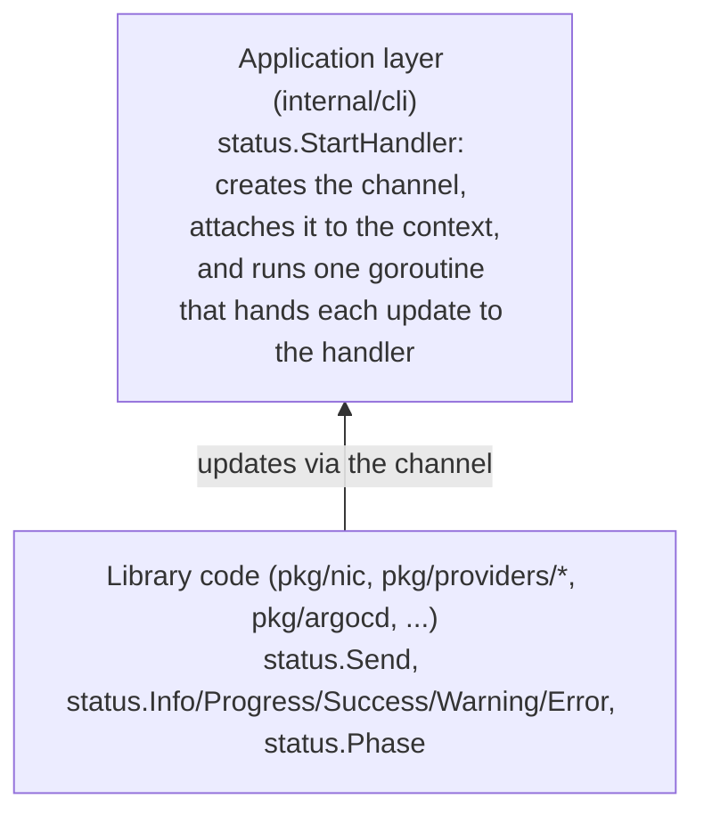

# Status Update Mechanism

The status package (`pkg/status/status.go`) provides a **context-based, non-blocking channel system** for sending progress updates from library code (`pkg/`) to the application layer (`internal/cli`) without introducing logging dependencies in the library code.

## Architecture



The handler the CLI installs depends on `--log-format`: the `internal/output` renderer for `pretty`, `plain` and `github`, or `pkg/nic`'s `SlogHandler` for `json`. For `deploy` and `destroy` it also feeds a second `SlogHandler` that writes the run's JSON log file (see "Output" below).

## Status Levels

- **`LevelInfo`** - Informational messages
- **`LevelProgress`** - Operations in progress (creating, discovering, waiting)
- **`LevelSuccess`** - Successful completion
- **`LevelWarning`** - Non-fatal issues
- **`LevelError`** - Error conditions

## Setup (Application Layer)

`deploy` and `destroy` start the handler through `startCommandOutput` in `internal/cli/output.go`, which picks the renderer for the resolved `--log-format` and opens the log file:

```go
ctx, out := startCommandOutput(ctx, "deploy", cfg, deployHeader(cfg, configFile), deployLogFile)
result, err := client.Deploy(ctx, cfg, opts)
out.finish(err) // flush, print the result line, close the log file
```

Commands that only need structured logs keep the simpler form, where `SlogHandler` in `pkg/nic/status.go` converts status updates to `slog` calls at the appropriate log level:

```go
ctx, cleanup := nic.StartSlogHandler(ctx, slog.Default())
defer cleanup()
```

## Phases

`pkg/nic` marks each stage of a deploy or destroy with `status.Phase(ctx, name)` (names in `pkg/nic/phases.go`). Every update until the next marker belongs to that phase: the renderer draws one panel per phase, and `SlogHandler` adds a `phase` attribute to each JSON record. Library code below `pkg/nic` doesn't announce phases; its updates land in whichever phase is open.

## Output

| `--log-format` | Used when | What it prints |
|---|---|---|
| `auto` (default) | always | `pretty` on a terminal, `plain` on a terminal with `NO_COLOR` or `TERM=dumb`, `json` otherwise |
| `pretty` | terminals | A panel per phase, drawn as soon as the phase starts and filled in as it runs, coloured results |
| `plain` | log files, dumb terminals | One line per step, no colour, nothing redrawn |
| `json` | pipes, CI, scripts | The `slog` JSON records. Compared with earlier releases, each phase adds a marker record (`resource: phase`), every record after it carries a `phase` attribute, and `deploy`/`destroy` log the log file's path |
| `github` | GitHub Actions | `plain`, with each phase in a log group and warnings and errors as annotations |

A deploy on a terminal (`pretty`): a local kind deploy as it runs, and an AWS deploy once it has finished. Both replay the status stream of a real run, with names anonymised, through `internal/output`; the animation keeps the real durations but shortens the two long waits:


`--verbose` (`-v`) also shows informational updates and tool output (OpenTofu events) under their phase. Whatever the format, `deploy` and `destroy` write every update as JSON to `~/.nic/logs/<project>/<UTC time>-<command>.jsonl` (`--log-file` to choose the path, `--no-log-file` to skip it).

## Usage in Library Code

### Simple message

```go
status.Info(ctx, "EKS cluster not found")
status.Progress(ctx, "Creating EKS cluster")
status.Success(ctx, "Node group deleted")
status.Warning(ctx, "GetKubeconfig not yet implemented")
status.Error(ctx, "Failed to create node group")
```

### Formatted message

```go
status.Infof(ctx, "Checking node group '%s' for updates", nodeGroupName)
status.Progressf(ctx, "Creating node group '%s' (%d/%d)", name, i, total)
```

### Full fluent API with resource/action/metadata

```go
status.Send(ctx, status.NewUpdate(status.LevelProgress, "Creating VPC").
    WithResource("vpc").
    WithAction("creating").
    WithMetadata("cidr", "10.0.0.0/16"))
```

## Real Examples from Codebase

### From `pkg/providers/cluster/aws/eks_delete.go:23-76`

```go
status.Send(ctx, status.NewUpdate(status.LevelProgress, "Checking EKS cluster"))
// ... check if cluster exists ...
status.Send(ctx, status.NewUpdate(status.LevelInfo, "EKS cluster not found"))
// or
status.Send(ctx, status.NewUpdate(status.LevelProgress, "Deleting EKS cluster"))
// ... wait for deletion ...
status.Send(ctx, status.NewUpdate(status.LevelSuccess, "EKS cluster deleted"))
```

### From `pkg/providers/cluster/aws/nodegroups_reconcile.go:67-117`

```go
status.Send(ctx, status.NewUpdate(status.LevelProgress,
    fmt.Sprintf("Creating node group '%s' (%d/%d)", nodeGroupName, i, len(awsCfg.NodeGroups))))

// On error:
status.Send(ctx, status.NewUpdate(status.LevelError,
    fmt.Sprintf("Failed to create node group '%s': %v", nodeGroupName, err)))

// On success:
status.Send(ctx, status.NewUpdate(status.LevelSuccess,
    fmt.Sprintf("Node group '%s' created and active", nodeGroupName)))
```

### From `pkg/providers/cluster/aws/vpc_reconcile.go:101-291`

```go
status.Send(ctx, status.NewUpdate(status.LevelProgress, "Creating missing internet gateway"))
// ... create IGW ...
status.Send(ctx, status.NewUpdate(status.LevelSuccess, "Internet gateway created"))
// or if already exists:
status.Send(ctx, status.NewUpdate(status.LevelInfo, "Internet gateway already exists"))
```

## Key Properties

1. **Non-blocking** - If the channel is full, messages are dropped (see `Send` in `pkg/status/status.go`), so handlers must stay fast
2. **Context-based** - Channel is stored in context, so no global state
3. **Safe to call without handler** - If no channel in context, `Send()` is a no-op
4. **Graceful shutdown** - `cleanup()` function closes channel and waits for handler to drain

## When to Use Each Level

On a terminal (`pretty` and `plain`), `Info` and `Progress` updates only show as the running panel's activity line (`pretty`), or not at all (`plain`): they are listed under their phase with `--verbose`, and in dry runs, whose `Would ...` lines are `Info`. Tool output (updates carrying `MetadataKeyDetail`) is listed only with `--verbose`. Everything reaches the JSON output and the log file. So a message a user must see on every run needs `Success`, `Warning` or `Error`.

| Level | Use Case | Example |
|-------|----------|---------|
| `Info` | State discovery, no changes | "EKS cluster not found", "Internet gateway already exists" |
| `Progress` | Long-running operation started | "Creating EKS cluster", "Deleting node groups" |
| `Success` | Operation completed successfully | "VPC created", "Node group deleted" |
| `Warning` | Non-fatal issues, stubs | "GetKubeconfig not yet implemented" |
| `Error` | Operation failed | "Failed to create node group: ..." |
